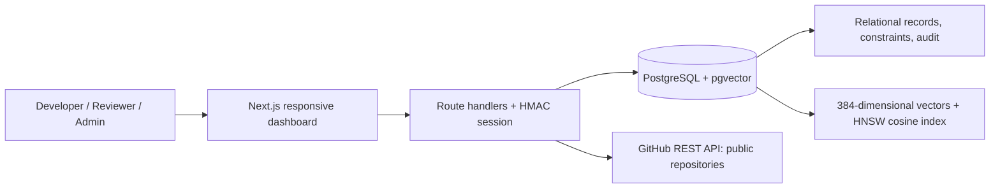
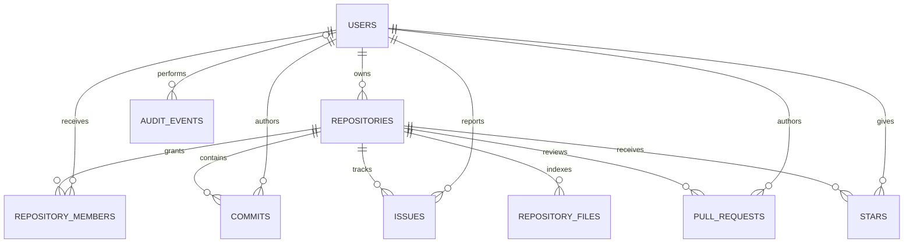

# System architecture

The browser only talks to same-origin Next.js route handlers. Route handlers validate inputs, verify the signed session, enforce access rules, and then use parameterized PostgreSQL statements. The public GitHub API is called server-side during an import. The optional GitHub token is kept in the server environment and is never sent to the client.

# Entity relationship model

`repository_members` and `stars` are associative relations with composite primary keys. Repository activity is summarized by a view; vector columns are attached to a repository summary or indexed file excerpt. Full definitions and constraints are in `database/schema.sql`.
